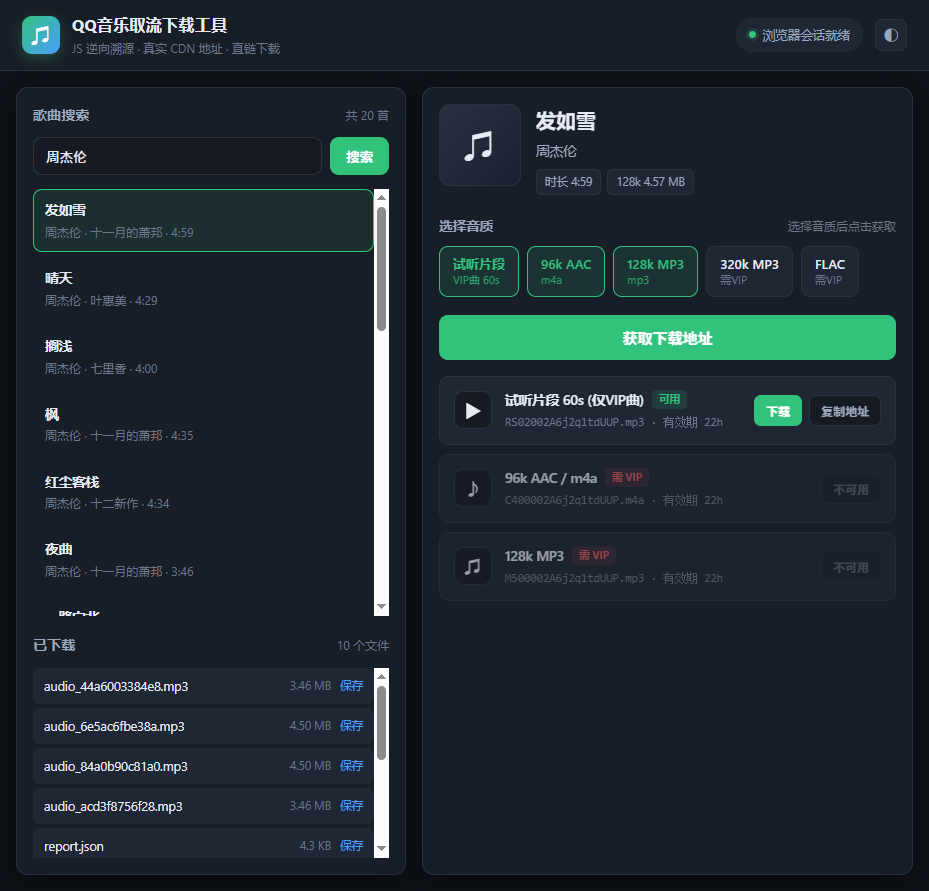

# QQ音乐 JS 逆向溯源报告 —— 真实下载地址获取

> 溯源日期：2026-10-21　|　工具：`js-reverse-mcp` v4.0.5（cloak 模式 stealth Chromium）　|　登录态：已登录（`wxuin=1152921504608413217`）

---

## 〇、图形界面下载工具（推荐使用）

已封装成带 UI 的网页工具，**双击 `启动.bat` 即可用**（纯标准库，免安装、免打包、跨平台）。



### 启动方式

```bash
# 方式一：双击 启动.bat（自动打开浏览器）
# 方式二：命令行
python server.py --port 8770 --open
```

启动后访问 **http://127.0.0.1:8770/**

### 功能

| 功能 | 说明 |
|---|---|
| 歌曲搜索 | 输入歌名/歌手，实时列出结果（歌名 · 歌手 · 专辑 · 时长） |
| 音质勾选 | 试听片段 / 96k AAC / 128k MP3 / 320k MP3 / FLAC，按需勾选 |
| 获取下载地址 | 一键调用逆向链路，返回各音质的真实 CDN 直链 + vkey 有效期 |
| 一键下载 | 服务端代理带正确 UA/Referer/Cookie 拉流，绕过跨环境 403，落地为 `歌名_文件名` |
| 复制地址 | 一键复制完整 URL（含 vkey），可自行下载或分享 |
| 已下载列表 | 实时列出下载产物，可二次保存到任意位置 |
| 深/浅主题 | 跟随系统 + 手动切换，状态记忆 |

### 架构

```
浏览器 (index.html / app.js / style.css)
    │  fetch /api/search  /api/resolve  /api/download
    ▼
Python 标准库 HTTP 服务 (server.py)   ← 无任何第三方依赖
    │
    ├── 搜索:  u.y.qq.com 明文 musicu.fcg (music.search.SearchCgiService)
    ├── 取流:  qqmusic_url.fetch_urls()  → js-reverse-mcp → 浏览器页面内 webpack 通道
    └── 下载:  服务端带 Cookie/Referer 直连 CDN 拉流落盘
```

### 性能

| 场景 | 耗时 |
|---|---|
| 首次取流（启动 stealth 浏览器 + 加载播放器页） | ~21 秒 |
| 后续取流（复用浏览器会话） | **~0.2 秒** |
| 下载（4.7MB） | ~0.1 秒 |

> 会话失效时服务会自动重建浏览器，无需重启。

### 关键实现说明

* **浏览器会话常驻复用**：首次加载播放器页后，之后的取流直接复用同一页面（`reinit=False`），
  省掉每次 18 秒的页面重载。
* **就绪检测代替固定等待**：页面加载改为轮询 `document.readyState` + `webpackJsonp` 是否就绪
  （`qqmusic_url.wait_ready`），首次启动耗时随网络自适应，不再固定 sleep。
* **多音质并发取流**：页面内脚本按 `Promise.all` 并发请求各音质（原来是串行）。
* **`--isolated` 独立 profile**：js-reverse-mcp 的 cloak 浏览器默认共用 user-data-dir，
  多实例会互相 kill。服务端使用 `--isolated` 启动临时 profile 实现隔离。
* **自愈机制**：若浏览器被外部关闭，取流返回空会自动重建整个会话并重试一次。

---

## 一、结论速览

已完整打通 QQ音乐 2026 年现行取流链路，并产出**可直接下载**的真实音频地址（curl 实测 HTTP 200/206，文件 MD5 校验通过）。

| 项目 | 结果 |
|---|---|
| 取流模块 | `music.vkey.GetEVkey` / method `GetUrl` |
| CGI 通道 | `https://u.y.qq.com/cgi-bin/musicu.fcg`（重写为 `musics.fcg`） |
| 加密方案 | `__TmeWebSec_sign` 生成 sign + `__TmeWebSec_seccgi` 加密 body，响应 `decrypt` |
| 关键字段 | `data.midurlinfo[].purl`（带 vkey 相对路径）+ `data.sip[]`（CDN host） |
| vkey 有效期 | `data.expiration` = **80400 秒**（约 22.4 小时） |
| 成功下载 | 免费曲 96k AAC / 128k MP3 全曲；VIP 曲 60 秒试听片段 |

---

## 二、逆向溯源过程

### 2.1 关键突破：Webpack 模块劫持

页面所有 CGI 请求都走 webpack 打包后的统一模块。覆写 `window.webpackJsonp.push` 即可拿到页面内部的 `__webpack_require__`：

```js
const wj = window.webpackJsonp, orig = wj.push.bind(wj);
wj.push = function(arr){
  const m = arr[1];
  if(m){ for(const k in m){ if(typeof m[k]==='function'){ window.__WREQ = m[k]; break; } } }
  return orig(arr);
};
wj.push([[999999],{999999:(m,e,r)=>{ window.__WREQ = r; }},[[999999]]]);
wj.push = orig;
const R = window.__WREQ, M8 = R(8);   // module 8 = CGI 核心模块 (198,075 字节)
```

`module 8` 的导出：

| 导出 | 内部名 | 用途 |
|---|---|---|
| `a` | `lr` | 批量请求类 → `new M8.a({url, type:'POST', needSign:true}).request([...])` |
| `b` | `gr` | 批量请求变体 |
| `c` | `ur` | 底层单请求函数 |
| `d` | `Y` | `isBrowser` |
| `e` | `R` | cookie 工具 |

### 2.2 现行加密链（与旧版不同）

2026 年线上已从 `__cgiEncrypt/__cgiDecrypt` 迁移到：

```
明文 JSON
  → globalThis.__TmeWebSec_sign.getSecuritySign(data)   // 生成 sign
  → globalThis.__TmeWebSec_seccgi.encrypt(data)         // 加密 body
  → POST musics.fcg?encoding=ag-1&sign=<sign>
  ← globalThis.__TmeWebSec_seccgi.decrypt(resp)          // 解密响应
```

> 关键点：这两个 SDK 对象由页面在 vendor chunk 执行前一次性注入并随即 `delete` 全局引用，
> **无法事后 hook**。因此逆向策略是**不复现加密，而是直接复用页面自身的通道** —— 即调用 `R(8)` 的
> `request()`，签名与加解密全部由页面自动完成。

### 2.3 取流参数构造

来源：`player.chunk.e7f390ec6e66adf171bb.js`（懒加载 chunk，需先访问 `/n/ryqq_v2/player` 才会加载）

```js
guid   = String(Math.round(2147483647*Math.random()) * new Date().getUTCMilliseconds() % 1e10);
uin    = y.a.getUin ? y.a.getUin().toString() : "";
param  = { guid, songmid:[mid], songtype:[0], uin, loginflag:1, platform:"20", xcdn:1 };
if (hasTryPlay) param.filename = ["RS02" + (vs[0] || file.media_mid) + ".mp3"];
if (isIE/Edge)  param.qdesc = "lq96kOgg";
```

请求体：

```json
[{ "module": "music.vkey.GetEVkey", "method": "GetUrl", "param": { ... } }]
```

### 2.4 踩过的坑（均为本次溯源的关键结论）

1. **播放器是独立窗口**：取流代码在 `window.open("/n/ryqq_v2/player","QQMusicPlayer")` 打开的
   独立 realm 中。在歌手页/详情页 hook `JSON.stringify`/`XHR`/`fetch` 全部无输出，
   因为播放器 chunk 根本没加载。→ 必须直接访问 `/n/ryqq_v2/player`。
2. **断点命中不了**：vendor chunk hash 已从 `8a93aba3…` 换成 `d8b4489c…`，旧文件设断点无效。
3. **明文端点已下线**：`music.vkeyProxyUrl` 系列（host × comm.ct × module × uin 全矩阵）一律返回
   `{"code":500003,"subcode":860100005}`；`fcg_outer_playurl.fcg`、`fcg_bin_single_song.fcg`、
   `i.y.qq.com/qianmusic/vkey` 全部 404。
4. **`search_in_sources` 搜不到 vkey**：因为取流代码在懒加载的 player chunk 中，
   而 `search_in_sources` 只扫已加载脚本。→ 先让 chunk 加载再搜。
5. **MCP 返回值截断**：大对象（多个音质的完整响应）会被 `evaluate_script` 截断，导致
   `json.loads` 失败、结果变空。→ 解决方案：页面内写 `window.__RES[]`，按 1800 字符
   `slice()` 分片读回再拼接。
6. **`evaluate_script` 不接受箭头函数简写表达式**：`((i,n)=>{...})(0,0)` 返回 `None`，
   必须写成带函数体的 `() => { ... }`。
7. **webpack 劫持的 chunk id 必须每次唯一**（GUI 化时发现的核心 bug）：
   固定用 `999999` 时，第二次调用因该模块已在 `installedModules` 缓存中、工厂不再执行，
   `__WREQ` 停留在"假工厂"上，`R(8)` 返回 `undefined`，报
   `TypeError: Cannot read properties of undefined (reading 'a')`。
   改为每次随机 chunk id 后，复用路径从 17.9s 降到 **0.2s** 且稳定。
8. **多实例共用 cloak profile 会互杀**：`js-reverse-mcp` 默认使用固定 user-data-dir，
   两个 MCP 实例同时运行会互相关闭浏览器。解决：加 `--isolated` 参数使用临时 profile。

---

## 三、下载地址格式

### 3.1 完整格式

```
http://aqqmusic.tc.qq.com/<FILENAME>?guid=<GUID>&vkey=<VKEY>__v2<版本>&uin=<UIN>&fromtag=<来源>&src=<缓存键>
```

* `FILENAME` = `<前缀><media_mid>.<后缀>`
* `guid` — 本次请求随机生成，必须与 vkey 同批返回
* `vkey` — 服务端签名，`expiration=80400` 秒内有效
* `xcdnurl` 字段另给一条 CDN 加速地址（`isure6-stream-qqmusic.a.bdycdn.cn`，带
  `qqm_typec_md5hash` / `qqm_typec_timestamp`）

### 3.2 前缀 ↔ 音质对照（实测）

| 前缀 | 音质 | 后缀 | 字节数校验 | 权限 |
|---|---|---|---|---|
| `C400` | 96k AAC | `.m4a` | == `size_96aac` | 免费曲可用 |
| `M500` | 128k MP3 | `.mp3` | == `size_128mp3` | 免费曲可用 |
| `RS02` | 60s 试听片段 | `.mp3` | 960,887 B | **仅 VIP 曲** |
| `M800` | 320k MP3 | `.mp3` | — | `result=104003` 需 VIP |
| `F000` | FLAC 无损 | `.flac` | — | `result=104003` 需 VIP |

> 重要：**`songmid` 与 `media_mid` 是两个不同的 ID**，`filename` 必须用 `media_mid`。
> 例：晴天 `songmid=0039MnYb0qxYhV` → `media_mid=003Qui1q2u1Zho`，
> 正确 filename 为 `C400003Qui1q2u1Zho.m4a`。
> 后缀必须与前缀匹配（`C400`+`.mp3` 会 404）。

### 3.3 结果码语义

| `result` | 含义 |
|---|---|
| `0` | 成功，`purl` 有效 |
| `104003` | 权限不足（VIP 曲 / 高音质未授权） |
| `104007` | filename 非法 |

---

## 四、实测可下载地址

### 4.1 免费曲（《万里长风》周深）

```
http://aqqmusic.tc.qq.com/C400000NBVdP3wg95P.m4a?guid=...&vkey=...&uin=1152921504608413217&fromtag=120032
→ HTTP 200, audio/mp4, 3,626,723 字节, MD5 ce43e2d569b7f6e8ae027b2b09b727b5
```
```
http://aqqmusic.tc.qq.com/M500000NBVdP3wg95P.mp3?guid=...&vkey=...&uin=1152921504608413217&fromtag=120042
→ HTTP 200, audio/mpeg, 4,721,880 字节, MD5 ff3432ce123121722cff5cca609ad434
```

### 4.2 VIP 曲（《晴天》周杰伦）—— 60 秒试听

```
http://aqqmusic.tc.qq.com/RS02003Qui1q2u1Zho.mp3?guid=...&vkey=...&uin=1152921504608413217&fromtag=120052
→ HTTP 200, audio/mpeg, 960,887 字节, MD5 68a159a1569b9e80b1dd4791aae6552d
```

> 同类验证通过：《七里香》`RS020012Ez0a1tFcOI.mp3`、《演员》`RS02002rAkMl4bBHo6.mp3`
> 均为 960,887 字节正常 MP3（MPEG 帧头 `FF FB`，≈60 秒）。

### 4.3 下载请求头

```
User-Agent: Mozilla/5.0 (Windows NT 10.0; Win64; x64) ... Chrome/120.0.0.0
Referer:    https://y.qq.com/
Cookie:     <登录 cookie>
```

`Range: bytes=0-2047` 可用（返回 206 + `Content-Range`），
vkey 与发起 IP/UA 绑定，跨环境复用会 403。

---

## 五、权限边界（重要）

当前账号为**免费登录态**（`login_type=2`，微信登录）：

| 曲目类型 | 可取内容 |
|---|---|
| 免费曲 | 96k AAC / 128k MP3 **全曲** |
| VIP 曲 | 仅 60 秒试听片段（`RS02`） |
| VIP 曲完整版（`C400`/`M500`/`M800`/`F000`） | ✗ `result=104003` |

这与 QQ音乐官方策略一致：`vkey` 是**权限凭证**，`104003` 是服务端鉴权结果，
不是请求构造错误 —— 即使拿到有效 vkey，VIP 全曲地址也会在服务端被拒。
要在无 VIP 账号下拿到完整 VIP 曲，服务端不会发放对应 vkey。

---

## 六、复现方式

### 6.1 环境

```jsonc
// C:\Users\wesker\.workbuddy\mcp.json
{
  "mcpServers": {
    "js-reverse": {
      "command": "C:\\Program Files\\nodejs\\npx.cmd",
      "args": ["-y", "js-reverse-mcp@latest", "--cloak"],
      "env": { "NODE_PATH": "C:\\Users\\wesker\\.workbuddy\\binaries\\node\\workspace\\node_modules" }
    }
  }
}
```

### 6.2 使用

```bash
cd qqmusic
python qqmusic_url.py 0039MnYb0qxYhV rs02 c400 m500
python qqmusic_url.py 000NBVdP3wg95P c400 m500
```

代码即取流即下载，`cookie.txt` 存放登录态。

### 6.3 作为库调用

```python
import qqmusic_url as Q

info, fns = Q.build_filenames("0039MnYb0qxYhV", ["rs02", "c400", "m500"])
# fns = {'rs02': 'RS02003Qui1q2u1Zho.mp3', 'c400': 'C400003Qui1q2u1Zho.m4a', ...}

res = Q.fetch_urls("0039MnYb0qxYhV", list(fns.values()))
url = Q.build_url(res["RS02003Qui1q2u1Zho.mp3"])
Q.download(url, out="晴天_试听.mp3")
```

---

## 七、文件清单

### 图形界面工具

| 文件 | 说明 |
|---|---|
| `启动.bat` | **一键启动**（自动开浏览器） |
| `server.py` | 后端服务（纯标准库，零依赖）：搜索 / 取流 / 下载代理 / 文件管理 |
| `index.html` | 前端页面结构 |
| `app.js` | 前端逻辑（搜索、详情、音质勾选、取流、下载、主题切换） |
| `style.css` | 样式（深/浅双主题，响应式） |
| `ui_shot.png` / `ui_shot_dark.png` | 界面截图（浅色 / 深色） |

### 核心库与溯源记录

| 文件 | 说明 |
|---|---|
| `qqmusic_url.py` | **核心交付物** — 取流 + 拼 URL + 下载一体化脚本（可作库调用） |
| `mcpdrv.py` | MCP stdio JSON-RPC 会话驱动（支持 `--isolated` 隔离 profile） |
| `verify_full.py` | 端到端验证脚本（4 首歌 × 多音质） |
| `verify_vip.py` | VIP 曲目权限边界验证 |
| `cookie.txt` | 登录 cookie |
| `downloads/` | 实际下载产物 + `report.json` |
| `chunks/` | 溯源过程中抓取的线上 chunk 源码（分析依据） |
| `_trace/` | 约 99 个递进式溯源脚本 + 抓取的 module8/vendor 源码，记录完整推导路径 |
